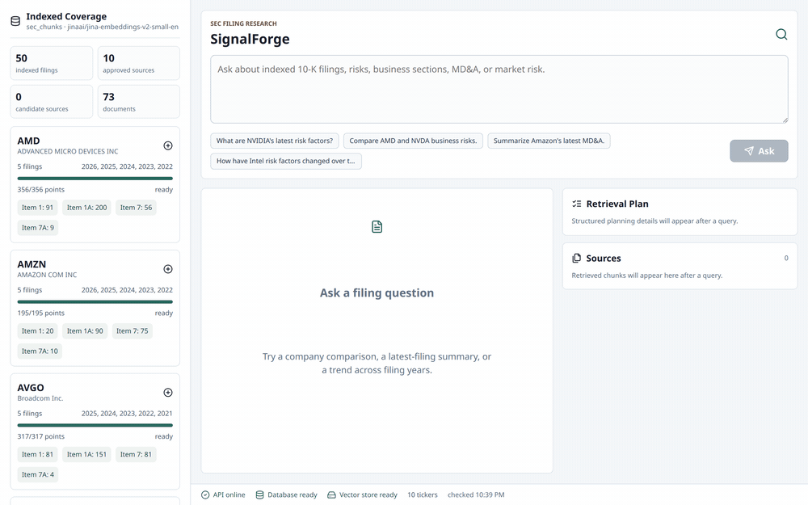
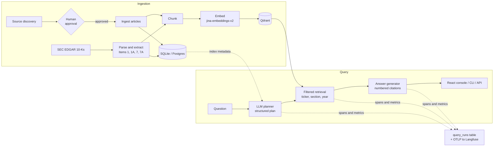

# SignalForge

**A retrieval-augmented research assistant that answers questions about public
companies with cited evidence from SEC 10-K filings and vetted company sources.**
It ships with an offline evaluation benchmark, per-query telemetry, and
OpenTelemetry tracing.




## What it does

- **Ingests SEC EDGAR 10-Ks** by ticker and extracts Business (Item 1), Risk
  Factors (1A), MD&A (7), and Market Risk (7A).
- **Discovers company sources** such as newsrooms, IR pages, blogs, and RSS/Atom
  feeds. A human approves each one before it is ingested.
- **Plans each question** with an LLM. The planner returns structured JSON with
  tickers, sections, filing years, time scope, intent, and search queries, and it
  is validated against what is actually indexed.
- **Retrieves filtered evidence** from Qdrant and **generates answers with
  numbered citations** to the filing section or article.
- **Measures itself**: a versioned offline benchmark, stage latencies, token
  usage, fallback counts, and content-free traces exported to Langfuse.

The current local index covers 10 tickers (AMD, AMZN, AVGO, GOOGL, INTC, META,
MSFT, MU, NVDA, QCOM), with 50 10-K filings and 73 source articles.

## Architecture



A background worker ingests approved sources and vectorizes new chunks on a
schedule. The FastAPI backend serves the React console and records every query
run.

## Key design decisions

- **Human-in-the-loop source approval.** Discovered sources are saved as
  candidates and never ingested automatically. Anything that enters the corpus
  ends up in the LLM's context, so source trust is an explicit and reviewable
  decision. This limits low-quality content and indirect prompt injection.
- **The planner is grounded in the index.** The planner sees which tickers,
  sections, and filing years exist, and its output is normalized against that
  metadata. A question about a year that was never ingested gets an explicit
  "not available" answer instead of a plausible guess from other years.
- **It degrades without an LLM.** If no API key is set or the provider fails,
  SignalForge falls back to a rule-based planner and an extractive answer
  generator. The app keeps working, and the fallback is counted in telemetry.
- **Evaluation comes first, and model output is never ground truth.** The
  benchmark is versioned and identified by a SHA-256 hash of canonical JSON, so
  results stay comparable over time. Promoting a real query into the benchmark
  requires a human to check every expected fact against the source passages.
- **Telemetry is honest and privacy-aware.** Missing provider usage is recorded
  as `unavailable` or `partial` and is never estimated from text length. Trace
  spans carry timings, counts, and model or prompt versions, but never the
  question, prompts, or source text.
- **Prompts are versioned.** The planner and answer prompts have version IDs
  that are stored on every query run and tracked in
  [`prompts/PLANNER_CHANGELOG.md`](prompts/PLANNER_CHANGELOG.md).
- **Storage is local-first and production-shaped.** It runs with zero
  infrastructure (SQLite and embedded Qdrant). The same code runs on Postgres and
  Qdrant server through Docker Compose, with Alembic migrations and a verified
  SQLite-to-Postgres migration tool.

## Evaluation

The planner is evaluated with `deepseek-v4-flash` at temperature 0, using prompt
`planner-v1.3.0`:

| Dataset | Cases | Score |
| --- | --- | --- |
| Benchmark v1 (lookup, synthesis, comparison, trend, missing and conflicting evidence) | 24 | **83%** (20/24) |
| Legacy planner golden set | 21 | **90%** (19/21) |

Tickers, filing years, and time scope were correct on every benchmark case. The
misses are intent-classification edge cases, such as `summary` instead of `fact`
on the conflicting-source questions. These are the next target for prompt work.

```bash
uv run python -m signalforge.cli.evaluate_planner --dataset evaluation/datasets/benchmark-v1.json
```

Benchmark v2 (`evaluation/datasets/benchmark-v2.json`) prepares retrieval
scoring. It keeps v1's 24 questions and plans, and adds a shared corpus of 111
synthetic passages tagged with ticker, section, and filing year. Each case grades
corpus passages as required (2) or related (1); anything unlisted is irrelevant.
Validation requires every answerable case to have at least three in-scope
distractors, so a retriever has to rank the right passage above wrong ones in the
same filing instead of returning everything that passes the filters.

The test suite has 166 Python tests (plus an optional Postgres profile) and
frontend tests with Vitest.

## Quickstart

Requirements: Python 3.11+, [`uv`](https://docs.astral.sh/uv/), and Node.js for
the frontend.

```bash
uv sync --extra dev
cp .env.example .env   # set SEC_COMPANY_NAME and SEC_EMAIL; DEEPSEEK_API_KEY is optional
```

Index a company and ask a question from the terminal:

```bash
uv run python -m signalforge.cli.ingest --ticker NVDA --limit 1
uv run python -m signalforge.cli.vectorize
uv run python -m signalforge.cli.answer_query "What are NVIDIA's main supply chain risks?" --show-plan
```

Or run the research console at `http://localhost:5173`:

```bash
make api        # FastAPI on :8000
make frontend   # React console on :5173
```

To run the full stack (Postgres, Qdrant, API, worker, and frontend on `:8080`):

```bash
docker compose up --build
```

## Tech stack

- **Backend:** Python, FastAPI, Pydantic, SQLAlchemy and Alembic
- **Retrieval:** Qdrant (embedded or server) with `jinaai/jina-embeddings-v2-small-en`
- **LLM:** DeepSeek (`deepseek-v4-flash`) through an OpenAI-compatible client,
  with a local fallback
- **Data:** SEC EDGAR and RSS/Atom/HTML sources, stored in SQLite or Postgres
- **Frontend:** React, TypeScript, and Vite
- **Ops:** Docker Compose, OpenTelemetry, Langfuse, pytest, Vitest, and Ruff

## Limitations and next steps

- Retrieval uses only the planner's first semantic query. Next steps are
  fusing all of them (multi-query plus reciprocal rank fusion) and adding a
  cross-encoder reranker.
- Retrieval is dense-only. A hybrid BM25 and dense setup would help with exact
  financial terms and figures.
- Retrieval and answer scores still need a fixture index built from the
  benchmark v2 corpus, plus recall@k and MRR computed against its relevance
  labels.
- Source discovery uses heuristics, and article extraction is tuned to the
  sources ingested so far.

## Tests

```bash
uv run pytest
cd frontend && npm test
```

---

SignalForge is a research tool, not financial advice. Verify important claims
against the original filing or source.
